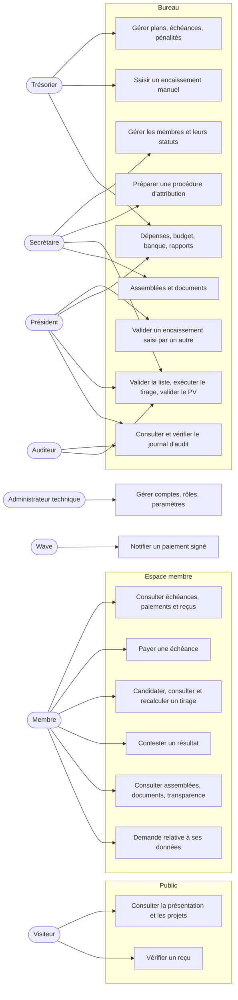
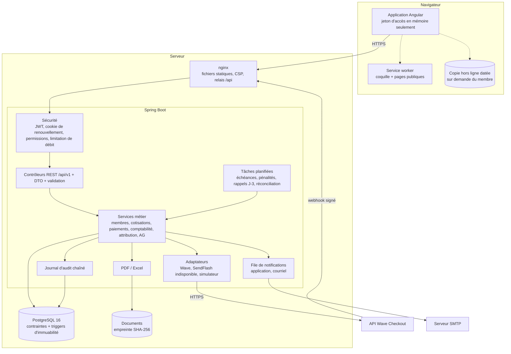
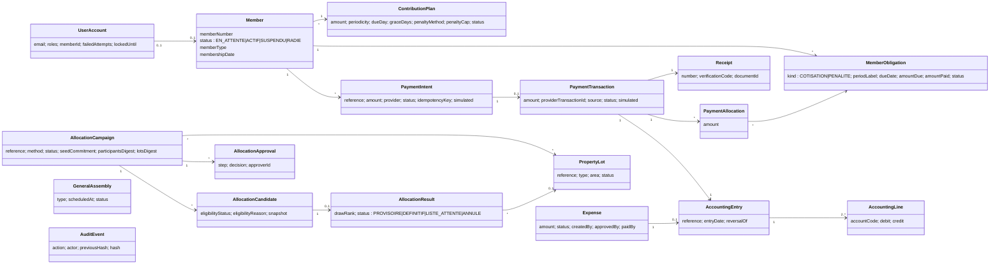
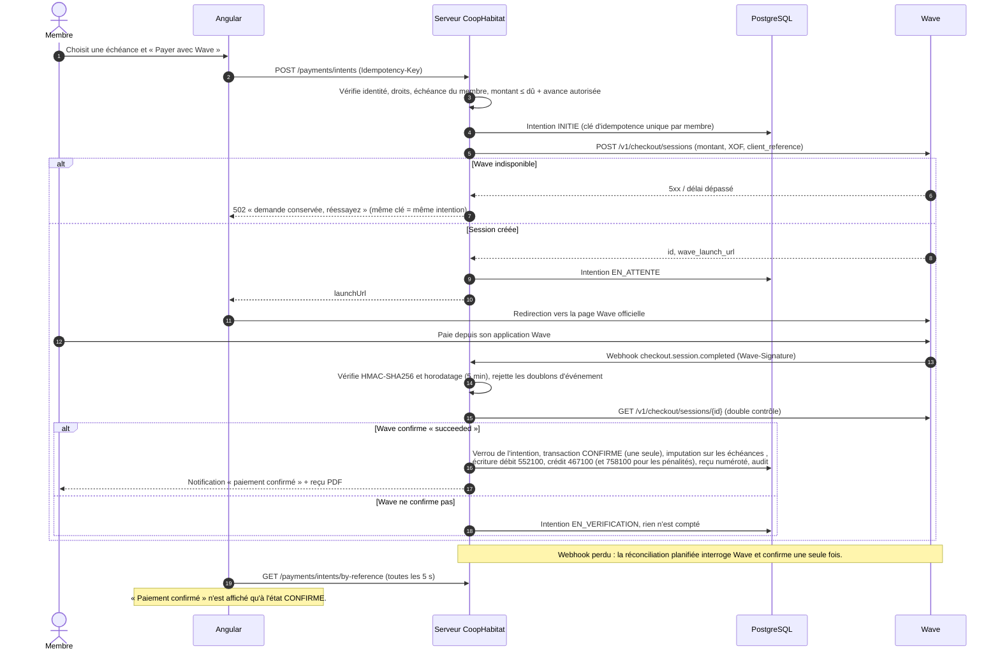
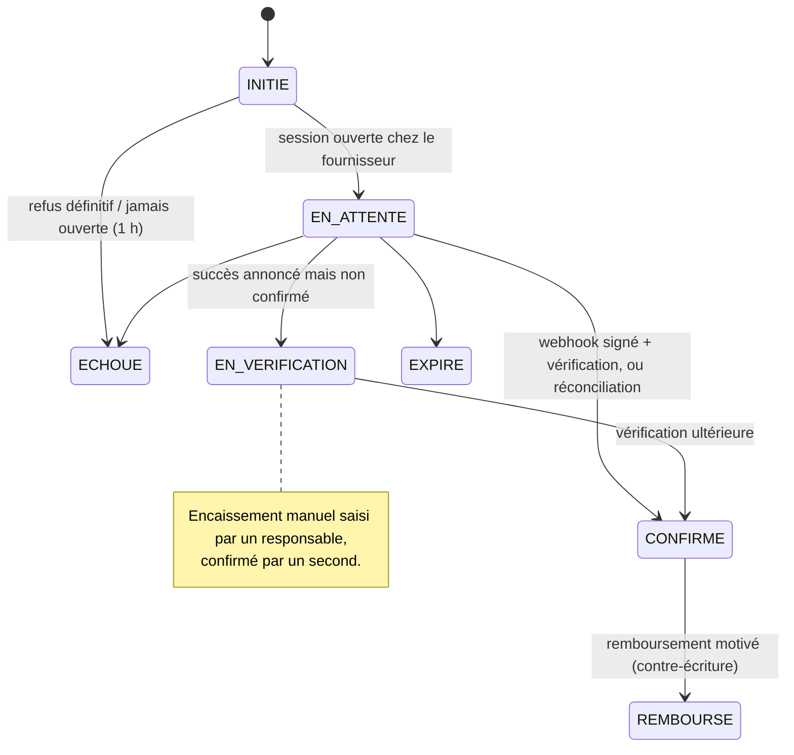
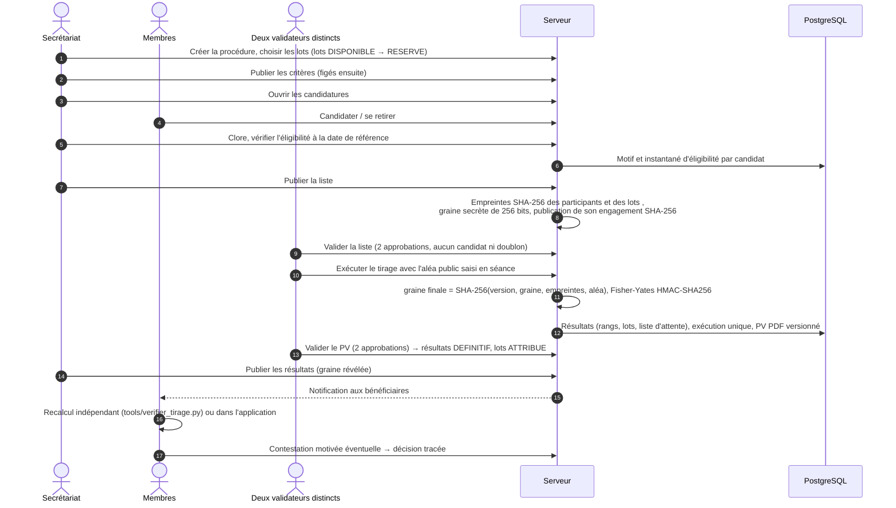
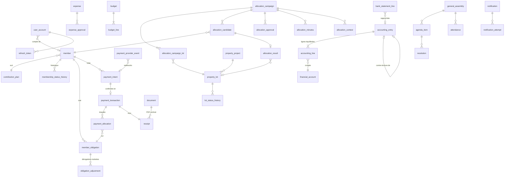
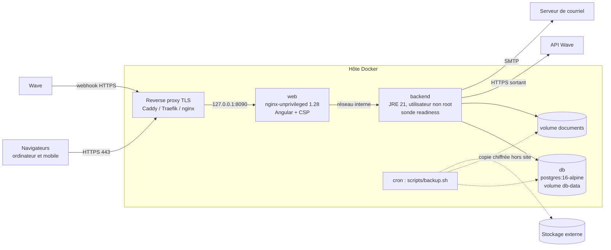

# Architecture de CoopHabitat

Ce document décrit l'organisation technique et contient les diagrammes UML demandés : cas d'utilisation,
architecture générale, classes métier, séquences de paiement et d'attribution, modèle de données et déploiement.
Les diagrammes sont écrits en [Mermaid](https://mermaid.js.org/), rendus directement par GitHub et GitLab.

## 1. Choix d'ensemble

| Couche | Technologie | Raisons |
|---|---|---|
| Interface | Angular 22 (composants autonomes, signaux, sans zone.js), SCSS sans bibliothèque d'interface | Application unique pour ordinateur et mobile ; aucun secret côté navigateur |
| API | Spring Boot 4.1, Java 21, Spring Security 7, Hibernate 7, Jackson 3 | Écosystème mature, transactions déclaratives, validation, OpenAPI |
| Données | PostgreSQL 16, Flyway | Transactions ACID, contraintes et triggers pour les invariants financiers |
| Documents | PDF générés par OpenPDF, Excel par Apache POI, stockage sur disque avec empreinte SHA-256 | Reçus, PV et rapports produits à partir des données persistées |
| Déploiement | Docker Compose : `db`, `backend`, `web` (nginx) | Séparation nette des trois composants, reproductible |

Le serveur est un **monolithe modulaire** : un paquet Java par domaine, chacun avec contrôleur, DTO, service,
dépôts et entités. Les intégrations externes (fournisseurs de paiement, courriel, SMS) sont isolées derrière des
interfaces (`PaymentProvider`, `ChannelSender`).

**Montants.** Tous les montants sont en francs CFA (XOF) sans décimale : `NUMERIC(15,0)` en base, `BigDecimal`
en Java, nombre entier dans l'API. Aucun nombre flottant. Les arrondis de pénalités suivent un mode déclaré dans
le plan (`HALF_UP` par défaut).

**Dates.** Instants stockés en UTC ; dates métier (échéances, date de référence) en `LocalDate` ; tâches
planifiées et calendrier dans le fuseau `Africa/Dakar`.

## 2. Cas d'utilisation

## 3. Architecture générale

**Frontend.** `core/` (client API, authentification, intercepteur, gardes, erreurs, libellés, copie hors ligne),
`ui/` (composants et pipes partagés), `layout/` (coquilles publique et connectée, bandeaux), `features/`
(un dossier par espace : `public`, `auth`, `account`, `member`, `bureau`, `bureau/finance`). Les types de l'API
(`core/api-types.ts`) sont générés depuis le contrat OpenAPI, ce qui garde frontend et serveur cohérents.
Toutes les routes sont chargées à la demande ; les écrans du bureau sont protégés par des gardes de permission,
mais **c'est le serveur qui décide** : chaque route REST porte son contrôle d'autorisation.

## 4. Classes métier principales

## 5. Séquence de paiement (Wave)

États d'une intention de paiement :

## 6. Séquence d'attribution par tirage au sort

États d'une procédure : `BROUILLON → CRITERES_PUBLIES → CANDIDATURES_OUVERTES → CANDIDATURES_CLOSES →
LISTE_PUBLIEE → VALIDEE → EXECUTEE → PV_VALIDE → RESULTATS_PUBLIES → ARCHIVEE`, avec `ANNULEE` possible avant
l'exécution. Le détail est dans [attribution-des-lots.md](attribution-des-lots.md).

## 7. Modèle de données

52 tables (migration `V1`). Vue des entités principales et de leurs relations :

Règles d'intégrité portées par la base (et pas seulement par le code) :

| Règle | Mécanisme |
|---|---|
| Journaux en ajout seul (`audit_event`, `accounting_entry`, `accounting_line`, `payment_allocation`, historiques de statut, approbations, tentatives de notification) | trigger refusant `UPDATE`, `DELETE`, `TRUNCATE` |
| Pas de suppression physique des membres, paiements, reçus, échéances, dépenses, rapports, lots, procédures, résultats, documents, assemblées, résolutions | trigger refusant `DELETE`/`TRUNCATE` (archivage par statut) |
| Écriture comptable équilibrée, au moins deux lignes | contrainte différée vérifiée en fin de transaction |
| Transaction confirmée : montant, membre, fournisseur, caractère simulé figés ; seul passage autorisé vers `REMBOURSE` | trigger |
| Reçu et contenu d'un document archivé figés | trigger |
| Une seule transaction par intention, un seul événement par identifiant fournisseur, une clé d'idempotence par membre | contraintes d'unicité |
| Un lot ne peut avoir qu'un résultat actif et n'être engagé que dans une procédure | index uniques partiels + verrous `SELECT … FOR UPDATE` |
| Concurrence sur les paiements et l'imputation | verrou pessimiste sur l'intention et sur le dossier du membre ; versions optimistes sur les entités modifiables |

Journal d'audit : chaque événement contient l'empreinte SHA-256 du précédent ; `GET /api/v1/audit/verify`
recalcule la chaîne et signale le premier maillon altéré.

## 8. Déploiement

La base et le serveur ne sont jamais exposés sur l'hôte ; seul le conteneur `web` l'est, sur `127.0.0.1` par
défaut. Détails : [deploiement.md](deploiement.md).

## 9. Mode hors ligne partiel

- Le service worker met en cache la coquille de l'application, les fichiers statiques et trois pages publiques
  (présentation, projets, documents publics), en « réseau d'abord ». Il **ne met jamais en cache l'API privée**.
- Un membre peut, s'il le demande, enregistrer une copie de sa situation sur son appareil. Elle est liée à son
  compte, datée, affichée avec la mention qu'elle n'est pas à jour, et effacée à la déconnexion (le service
  worker vide aussi ses caches).
- Aucune opération financière n'est possible hors ligne ; un bandeau signale la perte de connexion.
