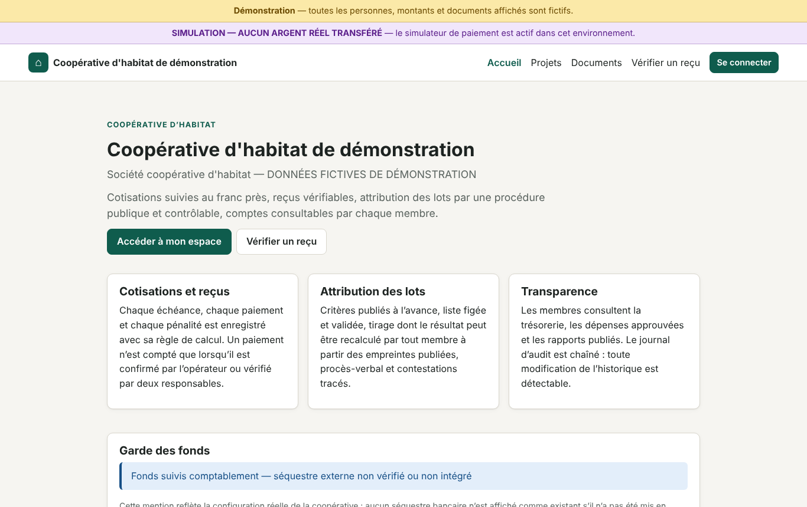
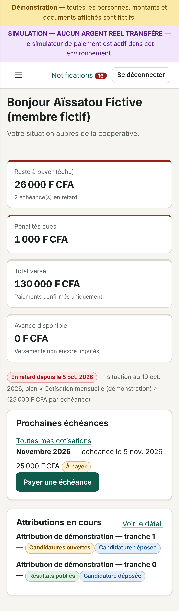
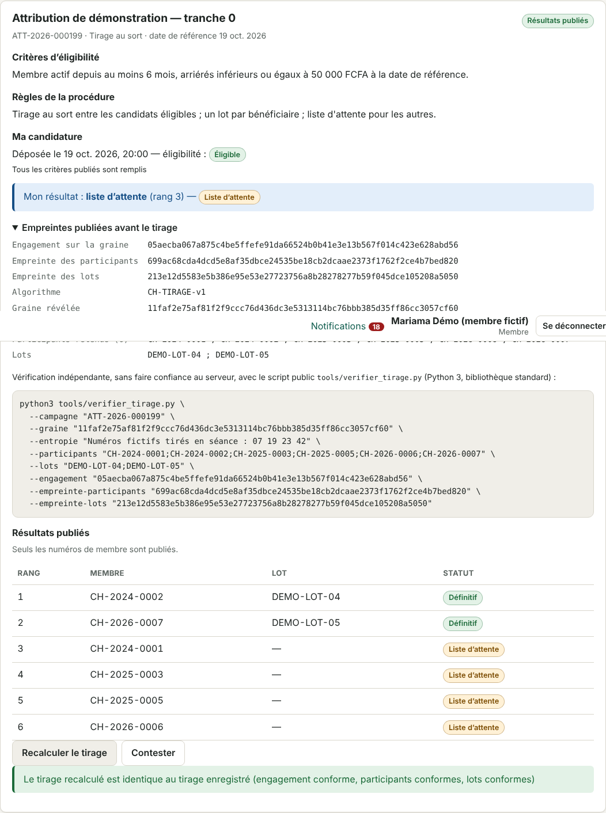
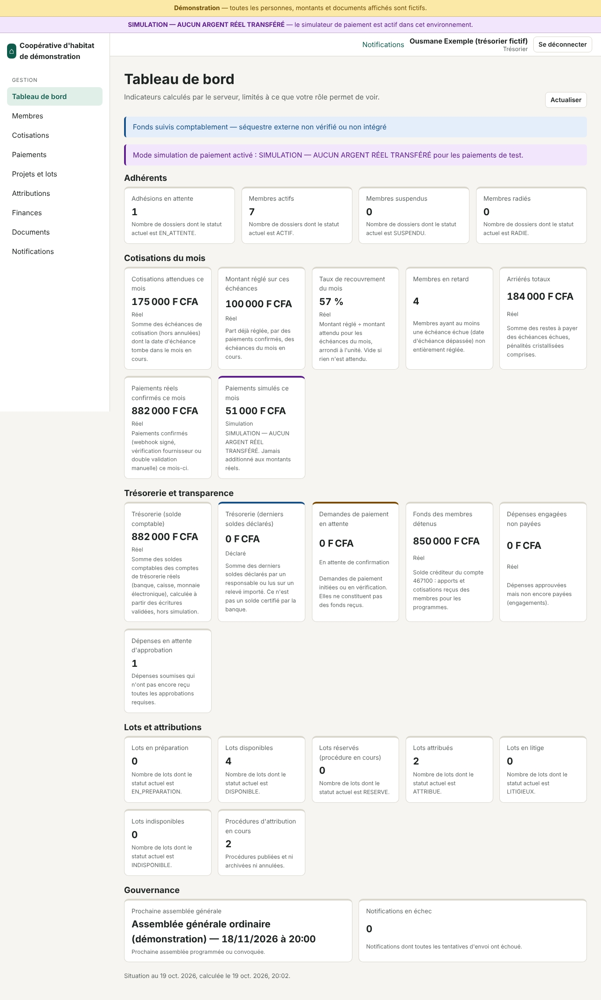
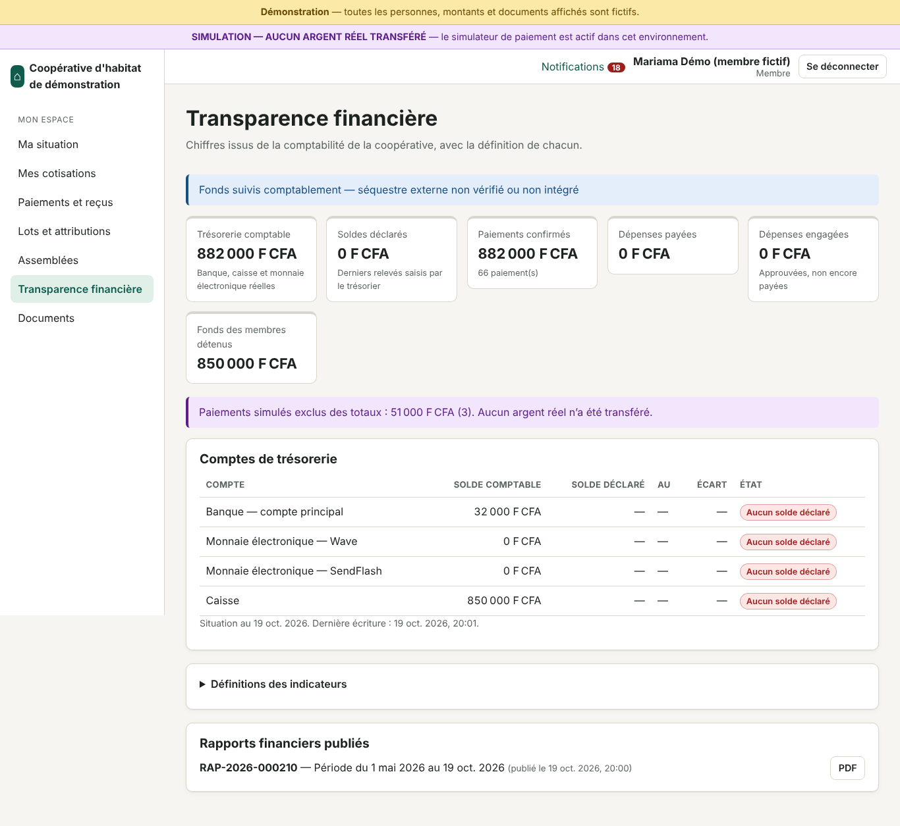

# Rapport final — CoopHabitat

Bilan établi le 19 octobre 2026, à partir de ce qui a réellement été exécuté dans l'environnement de
développement (Linux, Java 21, Node 24, PostgreSQL 16, Docker 29.8). Toutes les personnes, montants et documents
de démonstration sont fictifs.

> **En une phrase.** L'application est complète, cohérente et testée pour une **démonstration** ; elle n'est
> **pas prête à gérer des fonds réels** tant que les étapes de la section 10 (contrat Wave, audit, validation
> comptable et juridique, hébergement de production) ne sont pas accomplies.

## 1. Fonctionnalités réellement opérationnelles

Opérationnel signifie : implémenté de bout en bout (base, API, interface) et couvert par des tests qui passent.

| Domaine | Ce qui fonctionne |
|---|---|
| Comptes et sécurité | Connexion, jeton d'accès en mémoire et jeton de renouvellement en cookie HttpOnly avec rotation et détection de réutilisation, mots de passe Argon2id, verrouillage après échecs, limitation de débit, invitation et réinitialisation par lien à usage unique, 7 rôles et 41 permissions, séparation des rôles incompatibles |
| Adhérents | Création, statuts (actif, suspendu, démissionnaire…) avec motif et historique, export, espace personnel, mise à jour de ses coordonnées, demandes sur ses données |
| Cotisations | Plans de cotisation, génération idempotente des échéances (échéance ramenée à la fin du mois si besoin), pénalités forfaitaires ou en pourcentage avec délai de grâce et plafond, remises motivées, avances imputées automatiquement |
| Paiements | Intentions avec clé d'idempotence, plafond (restant dû + avance autorisée), confirmation idempotente, paiement partiel, échec, encaissements manuels (espèces, virement) validés par une seconde personne, remboursements par contre-écriture, réconciliation périodique des intentions en attente. **Une demande de paiement n'est jamais comptée comme un paiement** |
| Reçus | PDF généré pour chaque paiement confirmé, numéro séquentiel, montant en lettres, code de vérification public (`/verification-recu`), figé en base ; mention explicite « ni signature manuscrite ni signature électronique cryptographique » |
| Comptabilité | Partie double vérifiée par le service et par une contrainte en base, écritures en ajout seul (triggers), contre-écritures liées, dépenses à double contrôle, budget, soldes bancaires *déclarés* et import de relevés CSV avec rapprochement |
| Transparence | Page membre d'agrégats séparant comptable, déclaré, en attente et simulé ; mention « Fonds suivis comptablement — séquestre externe non vérifié ou non intégré » ; aucune donnée individuelle d'un autre membre |
| Rapports | Rapports figés à la génération, PDF archivé avec empreinte, publiés par une autre personne ; exports Excel (formules neutralisées) |
| Programmes et lots | Programmes, lots, statuts disponibles / réservés / attribués |
| Attribution | Procédure en 12 étapes, critères figés à la publication, éligibilité motivée, double validation, tirage CH-TIRAGE-v1 par engagement puis révélation exécutable une seule fois, PV PDF, contestation, annulation formelle ; double attribution impossible (index uniques). **Recalculable par chaque membre** dans l'application et avec `tools/verifier_tirage.py` (Python seul) |
| Assemblées | Convocation, ordre du jour, présence et procurations, quorum, résolutions et résultats saisis, PV |
| Documents | Dépôt contrôlé par contenu réel (pas seulement l'extension), visibilité publique / membres / bureau / privée, téléchargement contrôlé |
| Notifications | Boîte de réception, préférences, file d'envoi avec reprise ; **rappel J-3** envoyé une seule fois et rattrapé si une exécution est manquée ; courriel par SMTP si configuré |
| Audit | Journal chaîné par empreintes (SHA-256), en ajout seul, vérification de la chaîne depuis l'interface |
| Tableaux de bord | Espace membre (situation, échéances, paiements, attributions) ; tableau de bord du bureau dont les sections dépendent des permissions du rôle (présidence, trésorerie, secrétariat, audit, administration) |
| Site public | Présentation, projets, documents publics, vérification de reçu |
| Hors ligne partiel | Copie datée de sa propre situation, enregistrée sur demande, **toujours affichée comme non à jour** ; aucune action financière hors ligne |
| Exploitation | Images Docker non root, Compose (production, démonstration, développement), nginx avec en-têtes de sécurité et CSP stricte, refus de démarrage d'une production mal configurée, sauvegarde et restauration testées, CI GitHub Actions écrite |

## 2. Fonctionnalités disponibles uniquement en simulation

- **Simulateur de paiement** (`MOCK`) : crée de fausses sessions de paiement que l'on confirme ou fait échouer à
  la main. Chaque écran, reçu et total concerné porte « SIMULATION — AUCUN ARGENT RÉEL TRANSFÉRÉ ». Les montants
  simulés vont sur le compte 559900, exclu de la trésorerie et des totaux réels. **Le serveur refuse de démarrer
  en production si le simulateur est activé** (vérifié dans l'image Docker).
- **Données de démonstration** : 8 membres fictifs (domaine `.invalid`), bureau complet, échéances, paiements
  simulés, une procédure d'attribution terminée et une ouverte, une AG, un rapport publié. Chargées seulement si
  explicitement activées ; **refusées en production** (vérifié).

Aucune autre fonctionnalité n'est simulée.

## 3. Intégrations en attente d'identifiants ou d'autorisation

| Intégration | État | Ce qui manque |
|---|---|---|
| **Wave Checkout** | Adaptateur complet : création de session, webhook vérifié par `Wave-Signature` (HMAC, fenêtre de 5 minutes), **re-vérification de l'état auprès de Wave** avant de compter un paiement, remboursement. Testé contre un faux serveur conforme à la documentation publique | Contrat marchand, clé API, secret de webhook, URL HTTPS publique ; puis un essai réel avec de petits montants. Désactivé par défaut (`COOPHABITAT_WAVE_ENABLED=false`) |
| **SendFlash** | Adaptateur **volontairement indisponible** : il répond « fournisseur non disponible » et ne simule rien | Aucune documentation officielle de l'API n'a pu être confirmée ; intégration à écrire une fois la documentation et un contrat obtenus |
| **SMS** | Aucun fournisseur intégré | Choix d'un fournisseur, contrat, identifiants |
| **Courriel (SMTP)** | Fonctionnel si un serveur SMTP est fourni ; sinon les notifications restent dans l'application et le lien d'activation de l'administrateur initial est écrit une fois dans le journal du serveur | Identifiants SMTP (facultatif) |
| **Banque** | Aucun accès direct ; soldes déclarés ou relevés CSV importés | Une API bancaire et une autorisation, si la banque en propose |

## 4. Tests exécutés et résultats

Tous exécutés le 19 octobre 2026 dans cet environnement ; détail dans [tests.md](tests.md).

| Suite | Résultat |
|---|---|
| Serveur `mvn -B verify` (unitaires + intégration sur PostgreSQL 16 réel par Testcontainers) | **77 tests, 0 échec**, BUILD SUCCESS |
| Vérificateur Python du tirage (`python3 -m unittest discover tools`) | 1 test réussi (vecteur de référence identique à celui du serveur) |
| Frontend `npm run lint` | 0 erreur |
| Frontend `npm test` (Vitest) | **13 tests, 0 échec** |
| Build de production Angular | réussi, 376 ko initiaux (99 ko compressés) |
| `npm audit --omit=dev` | 0 vulnérabilité |
| Playwright (ordinateur + Pixel 7) contre le serveur de développement | **14/14** |
| Playwright contre la pile Docker de démonstration reconstruite (port 8090) | **14/14**, aucune violation CSP ni erreur JavaScript |
| Garde-fous de production dans l'image Docker | démarrage refusé avec simulateur, données de démonstration, cookie non sécurisé ou secret JWT trop court |
| Démarrage propre en production | paramètres « à configurer », simulateur et Wave signalés indisponibles, lien d'activation à usage unique accepté une fois (204) puis refusé (400), connexion réussie |
| Sauvegarde → modification → restauration | retour exact (371 événements d'audit, 68 transactions), chaîne d'audit valide, confirmation incorrecte refusée |
| nginx | en-têtes de sécurité présents ; Swagger et `/actuator` renvoient 404 |
| Recalcul indépendant d'un tirage publié avec le script Python | résultat identique à celui publié |

Les 21 scénarios obligatoires du cahier des charges sont reliés à leurs tests dans [tests.md](tests.md#3-scénarios-obligatoires-du-cahier-des-charges).

**Non exécuté** : la CI sur GitHub (aucun dépôt distant n'a été créé ; chacune de ses commandes a été lancée
localement avec succès), tests de charge, tests d'intrusion, essai contre l'API Wave réelle.

## 5. Couverture mesurée

JaCoCo, mesurée par `mvn verify` sur les tests unitaires et d'intégration (seuil bloquant : 60 % des lignes) :

| Mesure | Valeur |
|---|---|
| Lignes | **79,7 %** |
| Instructions | 78,8 % |
| Branches | 58,3 % |

Le paquet `jobs` (déclencheurs planifiés, désactivés en test) est à 0 % ; les services qu'ils appellent sont
testés. Détail par paquet dans [tests.md](tests.md). La couverture du frontend n'est pas mesurée.

## 6. Commandes de démarrage

```bash
# Démonstration complète (Docker) : base, serveur, frontend, données fictives, simulateur signalé
COOPHABITAT_DEMO_PASSWORD='Demo-CoopHabitat-2026' scripts/demarrer-demo.sh
# équivalent : docker compose -f docker-compose.yml -f docker-compose.demo.yml up -d --build --wait

# Production (après avoir rempli .env depuis .env.example)
docker compose up -d --build --wait

# Développement
docker compose -f docker-compose.dev.yml up -d          # PostgreSQL sur 127.0.0.1:5432
cd backend && mvn spring-boot:run                       # voir README, section 6, pour les variables
cd frontend && npm ci && npm start

# Vérifications
scripts/verifier-tout.sh                                # tests serveur, couverture, Python, lint, tests et build frontend
scripts/backup.sh /chemin/sauvegardes
scripts/restore.sh /chemin/sauvegardes/<dossier> --confirmer coophabitat
```

## 7. URL locales vérifiées

| URL | Usage | Vérifiée |
|---|---|---|
| <http://localhost:8080> | Pile Docker (frontend + `/api`) | Oui, sur le port 8090 (`COOPHABITAT_HTTP_PORT=8090`, le 8080 étant pris par le serveur de développement) ; 8080 est la valeur par défaut |
| <http://localhost:8080/api/v1/…> | API du serveur lancé directement | Oui |
| <http://localhost:8080/swagger-ui.html> | Swagger, serveur lancé directement avec `COOPHABITAT_SWAGGER_ENABLED=true` | Oui (redirection 302 vers l'interface, contrat chargé) |
| <http://localhost:4200> | Frontend en développement (`npm start`) | Oui |

Swagger n'est **pas** publié par la pile Docker (nginx renvoie 404) ; le contrat est versionné dans
[openapi.json](openapi.json).

Comptes de démonstration : `presidence@`, `tresorerie@`, `secretariat@`, `audit@`, `admin@`,
`membre1@` … `membre8@demo.coophabitat.invalid`, avec le mot de passe choisi dans `COOPHABITAT_DEMO_PASSWORD`.

## 8. Variables d'environnement requises

Modèle commenté : [`.env.example`](../.env.example). Le serveur refuse de démarrer en production si une valeur
obligatoire manque ou est dangereuse.

| Variable | Obligatoire | Rôle |
|---|---|---|
| `COOPHABITAT_ENVIRONMENT` | oui | `PRODUCTION`, `DEMONSTRATION`, `DEVELOPPEMENT` ou `TEST` |
| `COOPHABITAT_PUBLIC_URL` | oui | Adresse HTTPS publique (liens, CORS, retours Wave) |
| `COOPHABITAT_DB_PASSWORD` (+ `_DB_NAME`, `_DB_USER`) | oui | Base PostgreSQL |
| `COOPHABITAT_JWT_SECRET` | oui | 32 caractères minimum, aléatoire (`openssl rand -base64 48`) |
| `COOPHABITAT_COOKIE_SECURE` | oui en production (`true`) | Cookie de session réservé au HTTPS |
| `COOPHABITAT_BOOTSTRAP_ADMIN_EMAIL` | au premier démarrage | Administrateur initial, activé par lien à usage unique |
| `COOPHABITAT_HTTP_BIND`, `COOPHABITAT_HTTP_PORT` | non | Interface et port publiés par le conteneur web |
| `COOPHABITAT_WAVE_ENABLED`, `_WAVE_API_KEY`, `_WAVE_WEBHOOK_SECRET`, `_WAVE_SUCCESS_URL`, `_WAVE_ERROR_URL` | pour Wave | Paiement réel |
| `COOPHABITAT_MAIL_ENABLED`, `_MAIL_FROM`, `_SMTP_HOST`, `_SMTP_PORT`, `_SMTP_USER`, `_SMTP_PASSWORD` | non | Courriel |
| `COOPHABITAT_PAYMENT_MOCK_ENABLED`, `_PAYMENT_MOCK_SECRET` | démonstration seulement | Simulateur (interdit en production) |
| `COOPHABITAT_DEMO_ENABLED`, `_DEMO_PASSWORD` | démonstration seulement | Données fictives (interdites en production) |
| `COOPHABITAT_SWAGGER_ENABLED` | non (`false`) | Interface Swagger |

Aucun secret n'est présent dans le code frontend ni dans le dépôt.

## 9. Limites connues

- **Aucun audit indépendant** de sécurité, de conformité (loi n° 2008-12, CDP) ou comptable : l'application n'est
  ni certifiée ni réputée conforme. Plan de comptes simplifié « inspiré du SYSCOHADA », à valider.
- **Wave non testé en conditions réelles** ; **SendFlash non intégré** ; **aucun SMS**.
- **Aucune signature électronique** des reçus et PV (vérification en ligne par numéro et code seulement).
- **Aucun séquestre ni cantonnement des fonds** ; les soldes bancaires sont déclarés ou importés, jamais lus à la
  banque.
- **Pas de vote électronique** : les résultats des votes en séance sont saisis.
- **Pas de double authentification** (TOTP) pour les rôles financiers.
- **Pas de purge automatique** des données personnelles à l'expiration des durées de conservation (durées
  indicatives documentées, purge à faire manuellement).
- **Limitation de débit en mémoire** : une seule instance recommandée.
- **Hors ligne partiel** limité à la consultation de sa propre situation, datée et marquée non à jour.
- Pas de test de charge ni d'intrusion ; Playwright couvre les parcours principaux, pas chaque écran ; couverture
  du frontend non mesurée.
- CI fournie mais non exécutée sur GitHub ; aucun déploiement chez un hébergeur réel n'a été fait.
- Branches Git : `main` et `develop` existent localement ; le travail a été mené directement sur `main`, sans
  branches `feature/*` conservées.

## 10. Étapes nécessaires avant une utilisation réelle

1. **Décisions de la coopérative** : faire adopter par l'AG les règles de cotisation, de pénalité, d'éligibilité
   et d'attribution paramétrées dans l'application.
2. **Juridique** : formalités auprès de la CDP, politique de confidentialité, durées de conservation validées,
   contrat d'hébergement et localisation des données.
3. **Comptabilité** : validation du plan de comptes et des écritures par un expert-comptable ; si un séquestre
   est voulu, le mettre en place juridiquement et bancairement **avant** d'en faire état.
4. **Wave** : obtenir le contrat marchand et les clés, configurer le webhook sur l'URL HTTPS, faire un essai réel
   de petits montants (paiement, échec, remboursement) et un rapprochement avec le relevé Wave.
5. **Sécurité** : audit indépendant et test d'intrusion, double authentification des rôles financiers,
   procédure d'incident, rotation des secrets.
6. **Hébergement** : serveur permanent avec HTTPS (voir [deploiement.md](deploiement.md) ; les offres gratuites
   qui mettent en veille ne conviennent pas à des fonds réels), sauvegardes quotidiennes copiées hors site,
   restauration testée sur une autre machine, supervision.
7. **Dépôt et CI** : créer le dépôt distant (avec l'accord du porteur du projet), faire tourner la CI.
8. **Mise en service** : base vierge sans données de démonstration, simulateur désactivé, activation de
   l'administrateur initial, création du bureau, formation des responsables, période pilote en parallèle des
   registres existants.

## Annexe — captures (données fictives)

| | |
|---|---|
|  |  |
|  |  |
|  | |
